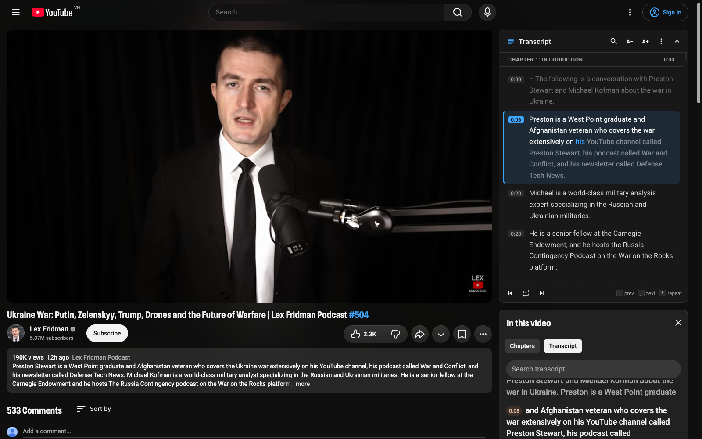
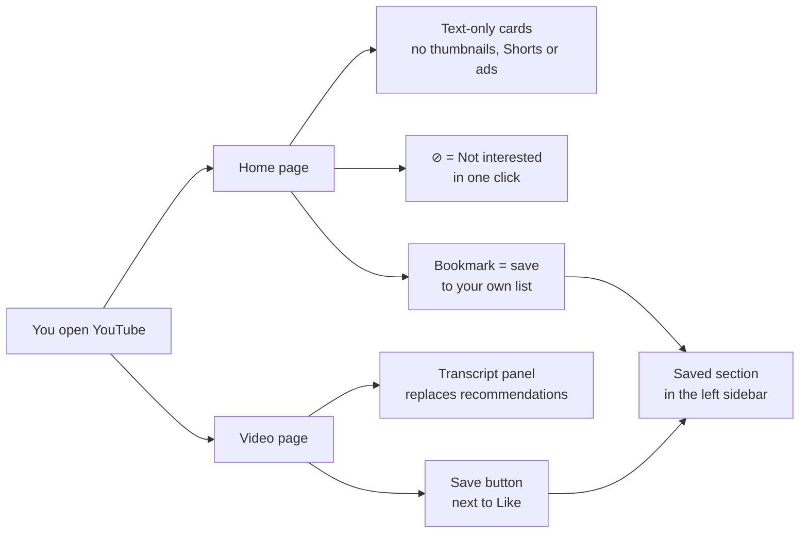
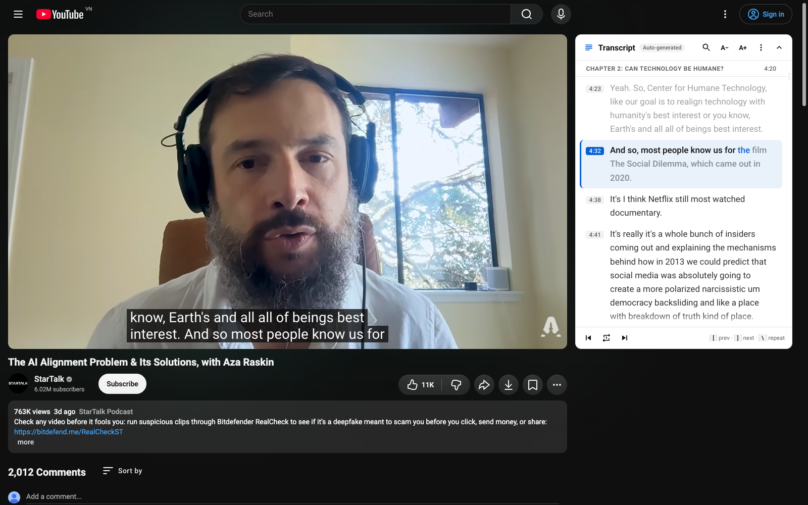
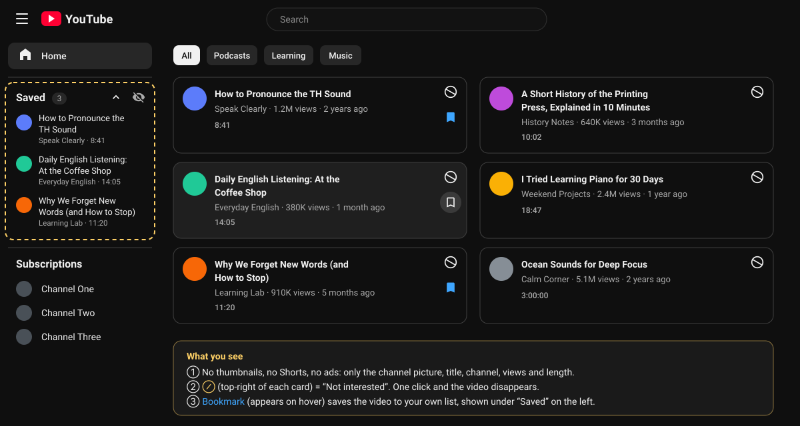
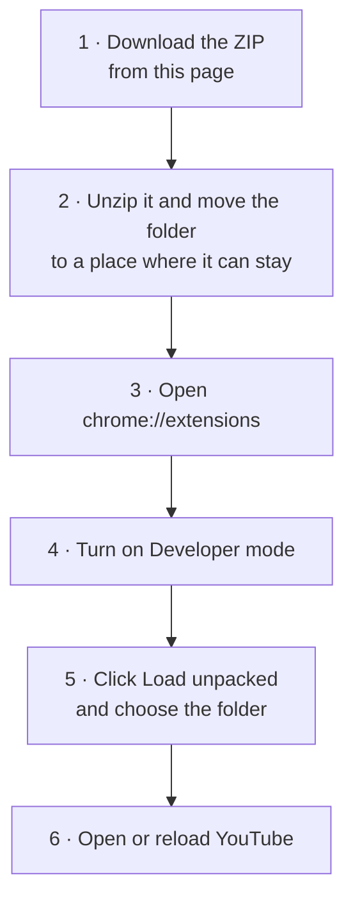
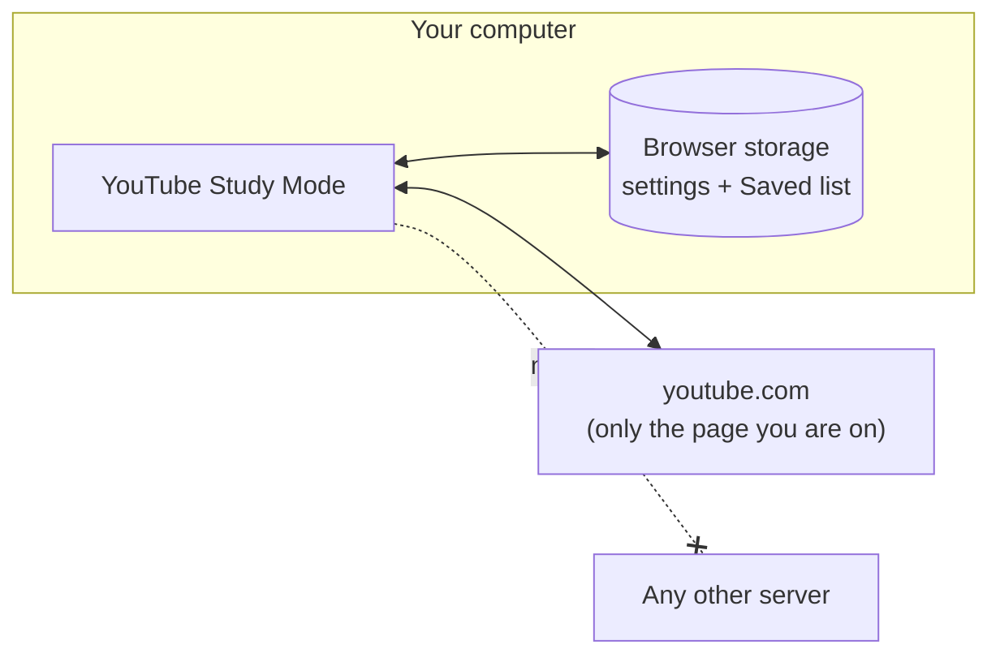
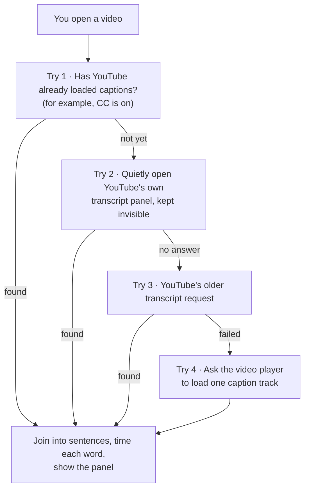
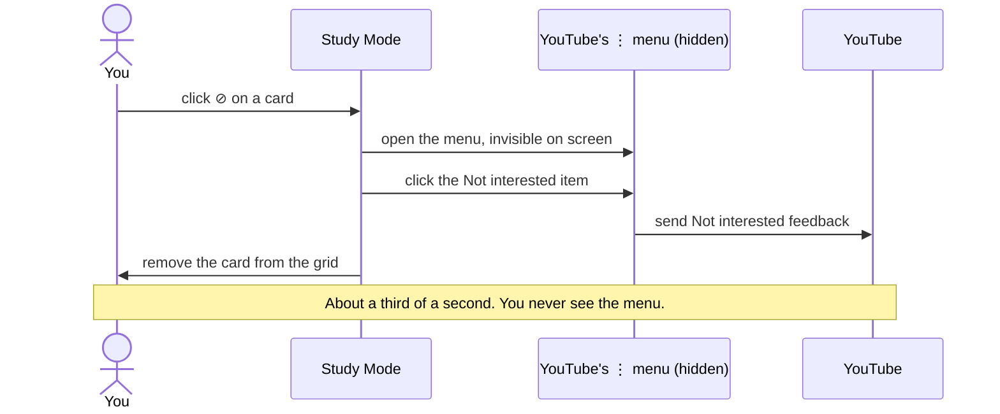
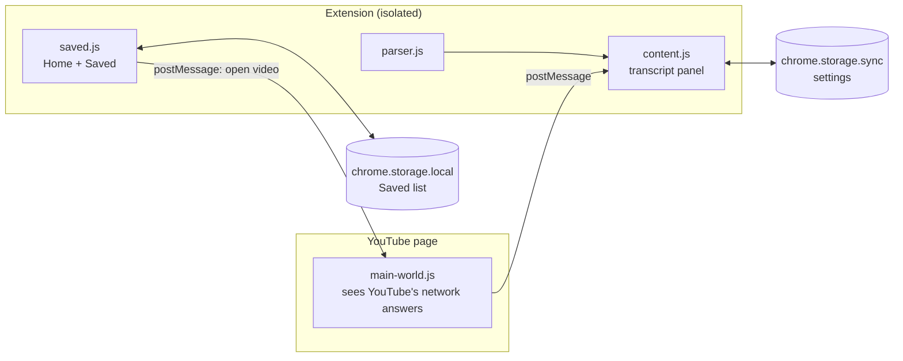

# YouTube Study Mode

**Turn YouTube into a place to learn, not a place to scroll.**

YouTube Study Mode is a free extension for **Google Chrome** (it also works in Microsoft Edge, Brave and other
Chrome-based browsers). It was made for people learning English with YouTube, but it helps anyone who opens
YouTube to watch one useful video and loses an hour instead.

It does three things:

1. **Shows a readable transcript next to the video.** Full sentences, the current one highlighted word by word,
   scrolling along with the video. Click any sentence to jump there.
2. **Makes the Home page calm.** No thumbnails, no Shorts, no ads. Just the title, the channel and the length,
   so you pick videos by what they are, not by how loud the picture is. Not interested in one? One click and it's gone.
3. **Gives you your own private "Saved" list**, right at the top of the left sidebar, stored only in your browser.



---

## Contents

- [What changes on YouTube](#what-changes-on-youtube)
- [Features in detail](#features-in-detail)
- [Install (step by step)](#install-step-by-step)
- [How to use it](#how-to-use-it)
- [Your privacy](#your-privacy)
- [How it works (for the curious)](#how-it-works-for-the-curious)
- [Update, turn off or remove](#update-turn-off-or-remove)
- [Questions and problems](#questions-and-problems)
- [Known limitations](#known-limitations)
- [For developers](#for-developers)

---

## What changes on YouTube

| Where | Normal YouTube | With YouTube Study Mode |
|---|---|---|
| **Video page**, right side | A long column of recommended videos, each with an eye-catching thumbnail | A **transcript panel**: the words being spoken, highlighted as they are said |
| **Video page**, under the title | Like · Share · ⋯ | A **Save** button is added before Like |
| **Home page** | A grid of big thumbnails, Shorts shelves and ads | A tidy grid of **text cards**: channel picture, title, channel, views, length |
| **Home page**, each card | ⋮ menu (several clicks to say "Not interested") | **⊘** button: one click = "Not interested", and the card disappears |
| **Any video card** (Home, Subscriptions, channel pages) | Nothing | A **bookmark** button appears when you point at the card |
| **Left sidebar** | Home, Subscriptions, You… | A new **Saved** section at the top, above Subscriptions |



---

## Features in detail

### 1. The transcript panel (video page)



| Feature | What it means for you |
|---|---|
| **Whole sentences** | YouTube's own captions cut sentences into random pieces. Study Mode joins them back and splits them at `.` `?` `!`, so you read real sentences. Auto-generated captions (no punctuation) are split into short phrases of about 7–24 words. |
| **Karaoke highlight** | Inside the sentence being spoken, words already said light up and the current word is blue. Great for shadowing. |
| **Click to jump** | Click any sentence and the video jumps there and plays. You can still double-click a word to select it (handy for a dictionary extension). |
| **Repeat a sentence** | Press the 🔁 button or the `\` key and the current sentence loops forever, until you press it again. |
| **Previous / next sentence** | `[` and `]`. The first `[` replays the current sentence from its start; press again to go one sentence back. |
| **Chapters** | If the video has chapters, the chapter title stays pinned at the top of the panel. Click it to jump to that chapter. |
| **Search** | Click 🔍, type a word, then `Enter` / `Shift+Enter` to jump between matches. |
| **Smart auto-scroll** | The panel scrolls with the video. Scroll up yourself to re-read and it stops following, showing a *Back to current* button; after 10 seconds without touching it, it follows the video again. |
| **Text size** | `A−` / `A+` (12 to 28 px). Your choice is remembered. |
| **Tidy toolbars** | The top toolbar (search, text size, menu) and the bottom one (previous / repeat / next) show only while your mouse is over the panel, and hide about 1 second after it leaves. |
| **Collapse** | The ⌃ button folds the panel away; YouTube's recommendations come back while it is folded. |
| **Copy transcript** | ⋮ menu → *Copy transcript* puts the whole text (with times, if shown) on your clipboard. |
| **Light and dark** | Follows YouTube's own theme automatically. |

### 2. A calm Home page



*(Illustration with made-up videos. Your own Home page shows your own recommendations.)*

- **Gone:** thumbnails, the Shorts shelf, ads in the feed, and the video preview that starts playing when you point at a card.
- **Kept:** the channel picture, the title, the channel name, views, age, and the video length (moved under the title).
- Every card has the **same height**, so the page reads like a neat list instead of a wall of posters.
- Want the pictures back for a moment? Click the **eye** icon next to *Saved* in the sidebar (or use the ⋮ menu on a
  video page). Click it again to hide them.

### 3. One-click "Not interested"

On the Home page, the ⋮ button of each card is replaced by **⊘**.

- **One click** tells YouTube you are *Not interested* in that video, exactly as if you had used YouTube's own menu.
- The card **disappears immediately**. There is no "Video removed / Undo / Tell us why" box.
- Over time YouTube learns what you don't want, and your Home page gets better.

> Clicked by mistake? There is no Undo button, but you can reverse it on
> [myactivity.google.com](https://myactivity.google.com) → *Other activity* → *YouTube "Not interested" feedback*.

### 4. Your own Saved list

| | |
|---|---|
| **Save a video** | Point at any video card and click the **bookmark** (it sits under ⊘). On a video page, click **Save** next to Like. |
| **Saved videos turn blue** | A saved video shows a blue, filled bookmark everywhere, so you see at a glance what you already saved. |
| **Find them** | They appear in the **Saved** section at the top of the left sidebar, newest first. The first 5 are shown; *Show more* lists the rest. |
| **Open one** | Click it. It opens instantly, without reloading the page. Ctrl/⌘-click opens it in a new tab. |
| **Remove one** | Point at it in the sidebar and click **×**, or click its blue bookmark again. |
| **Fold the section** | Click the word *Saved* to fold or unfold it. |

**Why not just use YouTube's "Save to playlist"?** This list is **yours alone**: it is never sent to YouTube or
Google, it does not feed YouTube's recommendations, and it is one click instead of three.

---

## Install (step by step)

This extension is not in the Chrome Web Store, so you install it yourself. It takes about two minutes and you
don't need any technical knowledge.



**1. Download.** At the top of this page, click the green **`<> Code`** button → **Download ZIP**.
(Or use this direct link: [main.zip](https://github.com/binhphuong-ab/YouTubeStudyMode/archive/refs/heads/main.zip).)

**2. Unzip and choose a permanent home for the folder.** Double-click the ZIP. You get a folder called
`YouTubeStudyMode-main`. Move it somewhere it can stay for good, for example your *Documents* folder.

> ⚠️ **Important:** Chrome remembers the extension by the folder's location. If you later move, rename or delete
> the folder, Chrome treats it as a different extension and **your Saved list and settings start empty again**.
> So pick the final place first.

**3. Open the extensions page.** In Chrome, type `chrome://extensions` in the address bar and press Enter.
(Edge: `edge://extensions`, Brave: `brave://extensions`.)

**4. Turn on Developer mode** with the switch in the top-right corner. Don't worry: this only allows you to
install extensions from a folder.

**5. Click "Load unpacked"** (top-left) and select the `YouTubeStudyMode-main` folder: the one that contains
the file `manifest.json`.

**6. Done.** Open [youtube.com](https://www.youtube.com) (or reload it if it was already open). Tip: click the
puzzle-piece icon in Chrome's toolbar and pin *YouTube Study Mode* if you like to see it.

> Chrome may show a small banner about "developer mode extensions" when it starts. That is normal for any
> extension installed this way; you can close it.

---

## How to use it

### Keyboard shortcuts (video page)

| Key | What it does |
|---|---|
| `[` | Replay the current sentence from its start. Press again to go one sentence back. |
| `]` | Jump to the next sentence. |
| `\` | Repeat the current sentence on a loop. Press again to stop. |
| `Enter` / `Shift+Enter` | In the search box: next / previous match. |
| `Esc` | Close the search box. |

The shortcuts don't fire while you type in a text box (YouTube's search, comments…). They use the **position** of
the key, not the character, so they keep working with other keyboard layouts and with typing tools such as
Vietnamese Telex/Unikey.

### Buttons on the transcript panel

| Button | Where | What it does |
|---|---|---|
| 🔍 | Top toolbar | Search inside the transcript |
| `A−` `A+` | Top toolbar | Smaller / larger text |
| ⋮ | Top toolbar | Settings menu (see below), *Copy transcript*, *Reload transcript* |
| ⌃ / ⌄ | Top toolbar | Fold / unfold the panel |
| ⏮ 🔁 ⏭ | Bottom toolbar | Previous sentence · repeat sentence · next sentence |
| *Back to current* | Over the text | Appears when you scrolled away; jumps back to what is being said |

### Settings (⋮ menu on the transcript panel)

All settings are remembered. Defaults are shown in the last column.

| Setting | What it does | Default |
|---|---|---|
| Join lines into sentences | Show whole sentences instead of YouTube's caption pieces | On |
| Karaoke word highlight | Light up words as they are spoken | On |
| Show timestamps | Show the time (e.g. `4:32`) in front of each sentence | On |
| Auto-scroll with video | Keep the current sentence in view | On |
| Hide recommended videos | Hide YouTube's recommendations under the panel | On |
| Auto-hide toolbars | Show the panel's toolbars only when the mouse is over it | On |
| Hide thumbnails on Home | The calm Home page described above | On |

The eye icon next to *Saved* in the sidebar switches *Hide thumbnails on Home* too.

---

## Your privacy

Short version: **nothing leaves your computer.** There are no accounts, no servers, no analytics, no tracking.

| Question | Answer |
|---|---|
| What data does the extension keep? | Your settings (text size, switches) and your Saved list (title, channel, channel picture link and length of each saved video). |
| Where is it kept? | Inside your own browser (Chrome's extension storage). Not on any server. |
| Is it sent to anyone? | No. The extension makes no connection to any website other than YouTube itself. |
| What permissions does it ask for? | Only **storage** (to remember the above), and it only runs on `youtube.com`. It cannot see your other tabs or websites. |
| Does "Not interested" talk to YouTube? | Yes, that is the point: it clicks YouTube's own "Not interested" for you, so YouTube receives the same feedback as when you use its menu. |
| Does the transcript come from a third party? | No. YouTube's own page loads the transcript; the extension just reads it (details below). |



---

## How it works (for the curious)

### Getting the transcript

Since late 2026, YouTube blocks the simple ways that older transcript extensions used to download captions
(the requests come back empty or with an error unless they carry a special token only YouTube's own code can make).
So Study Mode doesn't download anything itself. It **lets YouTube load the transcript, and reads the answer**:



### One-click "Not interested"

YouTube has no public button for this, so Study Mode uses YouTube's own menu, **invisibly**:



The menu item is recognised by its icon (a circle with a slash), so it keeps working if your YouTube is in
another language.

### The Saved list

Clicking a bookmark stores a small record (video ID, title, channel, channel picture link, length, date saved) in
the browser's extension storage. Every open YouTube tab listens for changes, so saving in one tab updates the
sidebar in all the others at once.

---

## Update, turn off or remove

| I want to… | Do this |
|---|---|
| **Update to a newer version** | Download the new ZIP, and copy its files **into the same folder** you installed from (replace the old files; keep the folder where it is). Then open `chrome://extensions` and click the ↻ (reload) icon on *YouTube Study Mode*. Your Saved list and settings are kept. |
| **Turn it off for a while** | `chrome://extensions` → switch *YouTube Study Mode* off. Switch it back on any time; nothing is lost. |
| **Remove it completely** | `chrome://extensions` → *Remove*. ⚠️ This also deletes your Saved list and settings. Then you can delete the folder. |

---

## Questions and problems

| Problem | What to try |
|---|---|
| The panel says **"No transcript found"** | The video may simply have no captions. If it does have them: turn on **CC** (subtitles) in the player, then click **Retry** in the panel. |
| The panel stays empty or keeps loading | Reload the page. If it still fails, use ⋮ → *Reload transcript*. |
| The transcript is in the "wrong" language | It uses the video's default caption language (usually the original language). Choosing a language isn't supported yet. |
| I don't see the Saved section | It lives in the full left sidebar. If you only see small icons on the left, click ☰ (top-left) to open the full sidebar. |
| I want the thumbnails back | Click the eye icon next to *Saved*, or ⋮ → *Hide thumbnails on Home* on a video page. |
| ⊘ turned red for a second and nothing happened | YouTube changed its menu and the extension couldn't find "Not interested" there. Please open an issue on this page. |
| My Saved list is suddenly empty | Was the folder moved or renamed? Chrome then sees a "new" extension. Move the folder back to where it was and reload the extension. |
| Something looks broken after a YouTube redesign | YouTube changes its layout often. Open an [issue](https://github.com/binhphuong-ab/YouTubeStudyMode/issues) with a screenshot. |

---

## Known limitations

- Desktop Chrome-based browsers only (not Safari, not Firefox, not phones).
- Works on regular video pages; **Shorts are not supported**.
- The calm Home page and ⊘ apply to the Home page only (bookmarks work on any video card).
- No language picker for the transcript yet.
- YouTube changes its website often. When it does, parts of the extension may need a fix.

---

## For developers

Plain JavaScript and CSS, no build step, no dependencies. Edit a file, click ↻ on the extension in
`chrome://extensions`, reload the YouTube tab.

```
manifest.json      Chrome extension manifest (Manifest V3; permission: storage only)
src/
  main-world.js    runs inside YouTube's page: watches YouTube's own fetch/XHR for transcript and caption
                   responses, and opens videos the way YouTube's links do (no reload)
  parser.js        understands YouTube's 4 transcript formats; builds sentences and word timings
  content.js       the transcript panel (in a Shadow DOM), loading pipeline, sync with the video, shortcuts
  styles.js        the panel's CSS (inside the Shadow DOM, so it never clashes with YouTube's)
  saved.js         Home without thumbnails, one-click Not interested, bookmarks and the Saved sidebar section
  page.css         CSS applied to YouTube's page itself (hidden recommendations, Home cards, Saved list)
icons/             extension icons
docs/              screenshots and the illustration used in this README
```



Notes:

- Everything visible on YouTube's page uses class names starting with `ytlt-`, so it is easy to find in DevTools.
- YouTube enforces *Trusted Types*, so the code never uses `innerHTML`; elements are built with a tiny `h()` helper.
- YouTube recycles video-card elements for other videos as you scroll, so `saved.js` re-reads a card at click time
  instead of trusting what it saw earlier.
